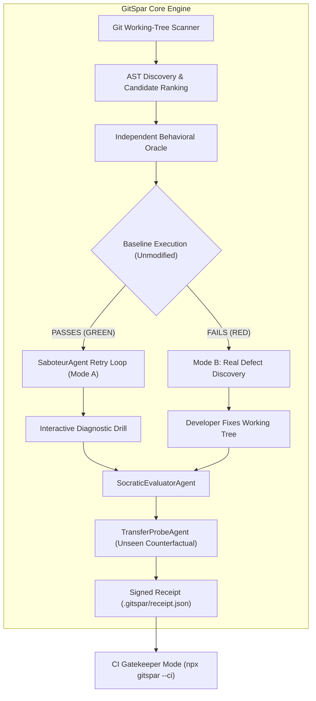

# GitSpar — Technical Architecture & System Design

**Author:** Devansh Doshi  
**System:** GitSpar (`gitspar`) — Verified Change Understanding Engine  
**Runtime:** Node.js (>=20), TypeScript (ESM / NodeNext)

---

## 1. Architectural Philosophy & The Core Problem

When engineers use AI assistants (Antigravity, Cursor, Claude Code, GitHub Copilot), code generation velocity often outpaces human comprehension. Pull requests frequently introduce subtle boundary errors and off-by-one regressions that pass superficial inspection.

Traditional automated testing tools face the classical **Test Oracle Problem**: if a tool inspects an AI-generated function and synthesizes tests to match the implementation, it simply verifies the bug against itself. If an implementation returns `price * 0.8` instead of the required 10% discount (`price * 0.9`), auto-generated assertions codify the erroneous behavior.

GitSpar addresses this through a **Neuro-Symbolic Verification Loop**:
1. Ground truth behavior is established *independently* from the code implementation (Blind Specification).
2. Code understanding is verified through controlled fault diagnosis, Socratic explanation grading, and counterfactual transfer probing.
3. Every verification generates a cryptographically signed receipt bound to the author's Git diff SHA-256 fingerprint.

---

## 2. Core Subsystems

### A. AST Static Analysis (`src/ast.ts`)
Using `ts-morph` and the TypeScript compiler API, GitSpar scans changed files in the working directory:
- **Function Discovery:** Identifies pure, deterministic exported functions with relational, equality, or boundary expressions. Filters out impure side-effectful functions (database clients, direct network calls, `process.env`).
- **Mutation Candidate Ranking:** Discovers all comparison operators (`>=`, `>`, `<=`, `<`, `===`, `!==`, `==`, `!=`) and arithmetic operators. Assigns a complexity score prioritizing boundary relational operators over simple equality checks.

### B. The 3-Stage Agentic Verification Loop (`src/agent.ts`)
Rather than relying on single-pass heuristics, GitSpar executes a multi-step agentic cycle:

1. **`SaboteurAgent` (Autonomous Mutant-Kill Retry Loop):**
   - Automatically iterates through ranked mutation candidates in an autonomous tool-use loop.
   - For each candidate, injects an AST mutation into a sandboxed copy, executes an isolated test run, and checks whether the author's oracle assertion turns `RED` (mutant killed) or stays `GREEN` (mutant survived).
   - Backtracks through candidates and records an explicit reasoning trace (`agent_reasoning_trace`) until finding a mutation that deterministically tests the boundary.

2. **`SocraticEvaluatorAgent` (Explanation Verification & Feedback):**
   - Evaluates the author's written diagnosis against:
     - Mutated variable and parameter identifiers from the AST.
     - The original vs. mutated operator and boundary values.
     - Causal reasoning mechanisms (`because`, `caused`, `when`, `due to`, `evaluated`, `instead of`).
   - If `GEMINI_API_KEY` is present in the environment, optionally queries Gemini 2.5 Flash via native `fetch` for conceptual accuracy grading.
   - Rejects trivial responses (`"I fixed the bug"`) and generates targeted Socratic feedback prompts guiding the author to articulate the boundary mechanism.

3. **`TransferProbeAgent` (Unseen Counterfactual Input Verification):**
   - Once a mutation is diagnosed or repaired, synthesizes an unseen test vector near the boundary (shifting numeric boundary values by $+1/-1$ or toggling boolean parameters).
   - Obtains ground-truth return values from the unmodified code.
   - Challenges the author to predict the return value without running the code, confirming that mental model comprehension generalizes beyond the specific test input.

### C. Cryptographic Diff Fingerprinting (`src/git.ts`)
Git working trees represent uncommitted state without an immutable commit hash. GitSpar computes:
- `base_commit_sha`: The latest local commit (`git rev-parse HEAD`).
- `working_diff_sha256`: A SHA-256 hash computed over `git diff HEAD` concatenated with any untracked target files.
Any modification made to the code after completing the drill invalidates the diff fingerprint, preventing replay attacks or subsequent unverified edits.

### D. CI Gatekeeper (`src/cli.ts --ci`)
Designed for automated PR pipelines (GitHub Actions):
- Resolves the comparison base ref (`git merge-base origin/main HEAD` or local branch base).
- Recomputes candidate diff hashes across the pull request.
- Reads `.gitspar/receipt.json`. If the diff SHA matches the verified receipt and all stages passed, exits with status `0`.
- If unverified changes exist or the receipt is missing, exits with status `1` and prints actionable instructions for local verification.

---

## 3. Technology Stack & Design Decisions

| Component | Technology | Rationale |
| :--- | :--- | :--- |
| **AST Parser** | `ts-morph` | High-level TypeScript AST manipulation with source-file round-tripping. |
| **Test Runner** | `vitest` | Fast, isolated TypeScript execution with native ESM support. |
| **Agentic Loop** | Native Node.js + Optional Gemini 2.5 Flash | Zero external runtime dependencies; operates 100% offline out-of-the-box. |
| **CLI I/O** | `node:readline` | Zero-dependency terminal interface avoiding ESM/CJS terminal conflicts. |
| **Web Portal** | Next.js 15, Tailwind CSS, React 19 | Serverless API route (`/api/spar`) with sandboxed `node:vm` execution. |
