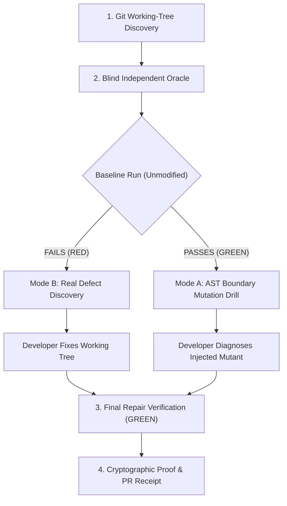

# GitSpar 🛡️ — Verified Change Understanding for AI-Assisted Code

> *"An editor-agnostic diagnostic gatekeeper that turns AI-generated code changes into executable comprehension drills."*

[](https://www.npmjs.com/package/gitspar)
[](LICENSE)
[](test/gitspar.test.ts)
[](package.json)

---

### 🌐 Live Web Portal & Interactive Simulator
- **Live Production App:** [https://web-lovat-pi-62.vercel.app](https://web-lovat-pi-62.vercel.app)
- **Live Interactive Mutation Simulator:** [https://web-lovat-pi-62.vercel.app/demo](https://web-lovat-pi-62.vercel.app/demo)
- **Reviewer & Hackathon Leaderboard:** [https://web-lovat-pi-62.vercel.app/dashboard](https://web-lovat-pi-62.vercel.app/dashboard)
- **Clean-Room Verification Portal:** [https://web-lovat-pi-62.vercel.app/verify/PR-1082](https://web-lovat-pi-62.vercel.app/verify/PR-1082)
- **Automated Engine Benchmarks:** [BENCHMARKS.md](BENCHMARKS.md) (100% mutant kill rate & CI enforcement).
- **Vercel Deployment Guide:** [DEPLOYMENT.md](DEPLOYMENT.md).

---

## 🌪️ The Problem

In the modern AI coding landscape (Antigravity, Cursor, Claude Code, GitHub Copilot, Codex, Windsurf), developers and students generate hundreds of lines of code in seconds ("vibe coding"). While raw speed has skyrocketed, it has opened two critical vulnerabilities:

1. **Cognitive Debt:** Authors commit large AI-crafted pull requests without deeply understanding boundary conditions, edge cases, or failure modes.
2. **The Reviewer Trust Gap:** Hackathon judges, university CS instructors, engineering leads, and open-source maintainers are inundated with AI submissions where the human author cannot explain, diagnose, or debug the code under review.

**GitSpar solves this without multiple-choice quizzes or synthetic toy puzzles.** It uses the developer's **own working-tree Git diff** to generate a fast, executable, and cryptographically verifiable **Change Understanding Assessment**.

---

## ⚡ How It Works: The 4-Step Loop

GitSpar is grounded in automated software testing principles and mutation analysis:



### 1. Cryptographic Git Working-Tree Fingerprinting
GitSpar scans tracked modifications (`git diff HEAD`) and untracked files, computing a SHA-256 fingerprint (`working_diff_sha256`) concatenated with `base_commit_sha`. The assessment is bound to the exact patch being reviewed.

### 2. Blind Independent Oracle (Solving the Oracle Problem)
Automated tools that inspect implementation code to generate assertions merely test a bug against itself. GitSpar shows the developer **only** the exported function signature (`name(params: types): returnType`) with the body completely hidden. The developer must independently state the boundary inputs (e.g. `100, false`) and expected output (`90`).

### 3. Dual-Mode Verification Engine
- **Mode B (`real_defect`):** If the unmodified code fails the developer's independent expectation, GitSpar routes to real defect diagnosis. The developer fixes their working tree until Vitest turns green.
- **Mode A (`mutation_drill`):** If the unmodified code passes, `ts-morph` injects a single deterministic AST boundary mutant (`>=` $\leftrightarrow$ `>`, `<=` $\leftrightarrow$ `<`, `===` $\leftrightarrow$ `!==`) into a temporary file. The developer must identify the mutated line, state the correct condition, and explain the root cause.

### 4. Verifiable Receipts
GitSpar generates `.gitspar/receipt.json` and `.gitspar/PR_RECEIPT.md` containing full diagnostic proof ready for GitHub Pull Requests.

---

## 🥊 Why Not Chat Quizzes?

Existing tools either rely on pre-made interview puzzles (PraxisAI, Codritium) or paste code into an LLM to generate multiple-choice chat questions (PR Guard, Own Your Diff). Here is why GitSpar is different:

| Capability | Copy-Paste Chat Quizzes (PR Guard, Own Your Diff) | GitSpar 🛡️ |
| :--- | :--- | :--- |
| **Assessment Target** | Generic LLM-generated trivia questions | Developer's exact Git working diff |
| **Execution Grounding** | None (pure text / chat interface) | **Isolated local Vitest test harness** |
| **Oracle Independence** | Biased by implementation body | **Strict blind signature oracle** |
| **Fault Injection** | Hallucinated hypothetical edge cases | **Deterministic AST boundary mutation (`ts-morph`)** |
| **Tamper Resistance** | Easy to feed directly back to another AI chat | Bound to local cryptographic diff SHA-256 |
| **CI / PR Automation** | Manual copy-pasting into PR | **Automated non-interactive CI check (`--ci`)** |
| **Tool Conflicts** | Often requires heavy external dependencies | **Zero-conflict native ESM (no `inquirer`/`chalk` collisions)** |

---

## 🚀 Quick Start (Local Setup)

### 1. Run via `npx`
Run directly in any Git repository containing TypeScript changes:
```bash
npx gitspar
```

Or target a specific module:
```bash
npx gitspar examples/checkoutDiscount.ts
```

### 2. Interactive Workflow
1. **Approve execution:** Approve running the selected pure function in the local test harness (`y`).
2. **Specify Blind Oracle:** Enter boundary input arguments (e.g. `100, false`) and expected return value (`90`).
3. **Diagnose & Repair:** Identify the mutated line number and write a concise 1-sentence diagnostic explanation.
4. **View Verified Receipt:**
   ```bash
   npm run receipt
   ```

---

## 🤖 GitHub Action Setup (CI Gatekeeper)

Add GitSpar as a gatekeeper to your repository so pull requests cannot be merged without verified proof of human understanding.

Create `.github/workflows/gitspar-gate.yml`:

```yaml
name: GitSpar Verification Gatekeeper

on:
  pull_request:
    branches: [ main, master ]

permissions:
  contents: read
  pull-requests: write

jobs:
  verify:
    runs-on: ubuntu-latest
    steps:
      - uses: actions/checkout@v4
        with: { fetch-depth: 0 }
      - uses: actions/setup-node@v4
        with: { node-version: 22 }
      - run: npm ci
      - run: npx gitspar --ci
      - uses: actions/github-script@v7
        if: always()
        with:
          script: |
            const fs = require('fs');
            if (fs.existsSync('.gitspar/PR_RECEIPT.md')) {
              const body = fs.readFileSync('.gitspar/PR_RECEIPT.md', 'utf8');
              github.rest.issues.createComment({
                owner: context.repo.owner,
                repo: context.repo.repo,
                issue_number: context.issue.number,
                body: `<!-- gitspar -->\n${body}`
              });
            }
```

If code is pushed without a valid receipt corresponding to the diff, the action fails with an actionable reminder:
```text
❌ GitSpar Check Failed: Working tree has unverified changes. Run `npx gitspar` locally to verify your changes before pushing.
```

---

## ⚙️ Configuration (`.gitspar/config.json`)

Customize GitSpar behavior via an optional `.gitspar/config.json`:

```json
{
  "baseBranch": "origin/main",
  "minExplanationLength": 15,
  "requiredMode": "mutation_drill"
}
```

---

## 🛡️ License

MIT © 2026 GitSpar Contributors.
